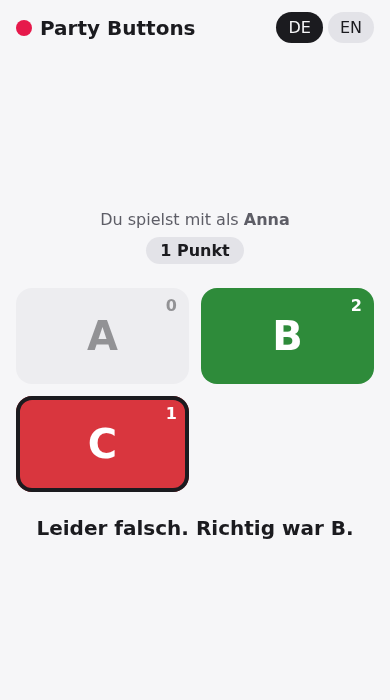

<div align="center">

# 🔴 Party Buttons

**Buzzer und Antwort-Knöpfe für Quiz- und Partyspiele, ohne Internet und ohne App für die Mitspielenden.**

[](https://github.com/aikitori/party-buttons/actions/workflows/android.yml)
[](https://github.com/aikitori/party-buttons/releases/latest)


[**APK herunterladen**](https://github.com/aikitori/party-buttons/releases/latest/download/party-buttons.apk)

  

</div>

## Features

- **Ein Handy ist der Host:** Die App startet ein Spiel im WLAN und zeigt einen QR-Code.
- **Mitspielen im Browser:** Scannen, Namen eingeben, los. Android und iPhone, keine Installation.
- **Buzzer:** Wer zuerst drückt, gewinnt. Der Host sieht Reihenfolge, Uhrzeit und Abstand in Millisekunden.
- **Antworten:** 2 bis 8 Knöpfe (A–H). Antworten bleiben verdeckt, bis der Host auflöst.
- **Punktestand:** automatisch für richtige Antworten, von Hand beim Buzzer.
- **Fair:** Die Laufzeit jedes Geräts wird gemessen und ausgeglichen.
- **Wiederverbinden:** Wer die Verbindung verliert oder neu lädt, ist wieder derselbe Spieler.
- **Offline:** Nur dasselbe WLAN oder der Hotspot des Hosts, kein Internet, kein Konto.
- Deutsch und Englisch, bis zu 20 Mitspielende.

## Spielen

1. App auf dem Host-Handy öffnen und **Spiel starten**.
2. Die anderen scannen den QR-Code oder geben die angezeigte Adresse ein.
3. **Buzzer** oder **Antworten** wählen und **Buzzer freigeben**.

Niemand kommt rein? In der App unter **Niemand kommt rein?** stehen die häufigsten Ursachen (Gäste-WLAN, mobile Daten).

## Entwickeln

Kotlin (Jetpack Compose, Ktor) für den Host, TypeScript (Vite) für die Seite der Mitspielenden.

```
core/     Spiel-Logik, reines Kotlin
server/   Webserver und WebSocket (Ktor), läuft auch auf dem PC
app/      Android-App
web/      Seite der Mitspielenden, wird in die App gepackt
```

```sh
cd web && npm ci && npm run build   # Seite bauen
./gradlew :core:test :server:test   # Tests
./gradlew :server:run               # ohne Handy im Browser ausprobieren
./gradlew :app:assembleDebug        # APK (Android-SDK nötig)
```

Jeder Push auf `main` baut ein signiertes APK als Release. Plan und Ideen: [PLAN.md](PLAN.md).
