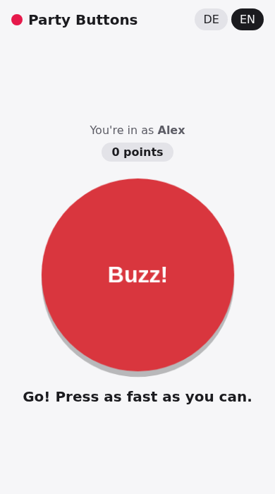
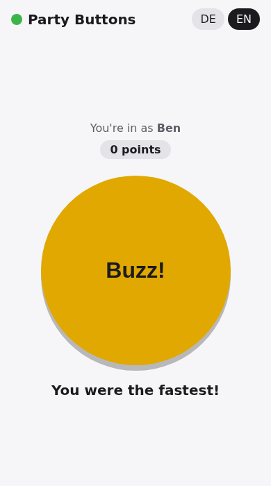
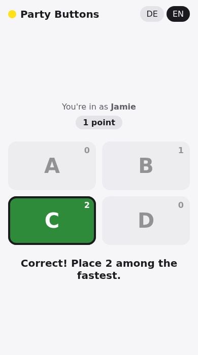

<div align="center">

# 🔴 Party Buttons

**Buzzers and answer buttons for quiz and party games. No internet, no app for the players.**

[](https://github.com/aikitori/party-buttons/actions/workflows/android.yml)
[](https://github.com/aikitori/party-buttons/releases/latest)

[](LICENSE)

[**Download APK**](https://github.com/aikitori/party-buttons/releases/latest/download/party-buttons.apk)

  

</div>

## Features

- **One phone hosts:** The app starts a game on the local Wi-Fi and shows a QR code.
- **Players use their browser:** Scan, enter a name, play. Android and iPhone, nothing to install.
- **Buzzer:** First press wins. The host sees the order, the time and the gap in milliseconds.
- **Answers:** 2 to 8 buttons (A–H). Answers stay hidden until the host reveals the correct one.
- **Scores:** automatic for correct answers, by hand for the buzzer.
- **Teams:** 2 to 6 teams, pick your own or let the host shuffle. Team score is the sum of its players.
- **Live overview for players:** everyone sees who buzzed and the team standings, never anyone else's answer.
- **Fair:** Each device's network delay is measured and compensated.
- **Reconnect:** Lose the connection or reload the page and you're still the same player.
- **Offline:** Same Wi-Fi or the host's hotspot is all it takes. No internet, no account.
- English and German, up to 20 players.

## How to play

1. Open the app on the host phone and tap **Start game**.
2. Everyone else scans the QR code or types the address shown.
3. Pick **Buzzer** or **Answers** and tap **Open buzzers**.

Nobody can join? The app's **Nobody can join?** button lists the usual causes (guest Wi-Fi, mobile data).

## Development

Kotlin (Jetpack Compose, Ktor) for the host, TypeScript (Vite) for the players' page.

```
core/     game logic, plain Kotlin
server/   web server and WebSocket (Ktor), also runs on a PC
app/      Android app
web/      players' page, bundled into the app
```

```sh
cd web && npm ci && npm run build   # build the players' page
./gradlew :core:test :server:test   # tests
./gradlew :server:run               # try it in a browser without a phone
./gradlew :app:assembleDebug        # APK (needs the Android SDK)
```

Every push to `main` builds a signed APK and publishes it as a release. Roadmap and ideas (German): [PLAN.md](PLAN.md).

## License

[MIT](LICENSE)
